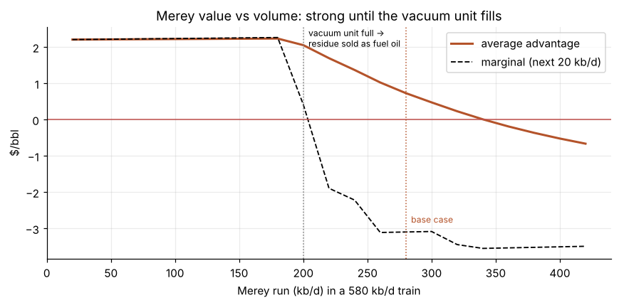
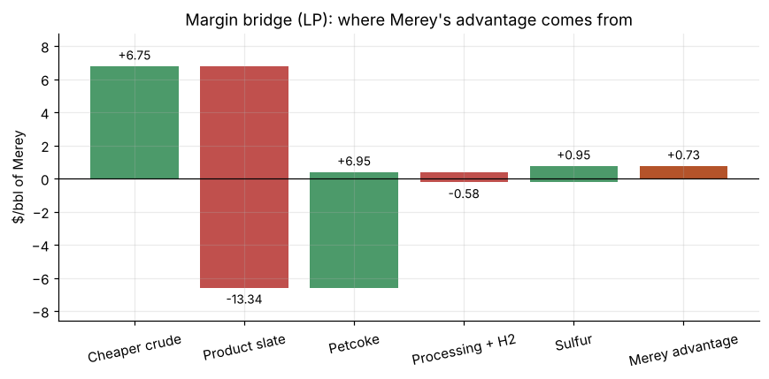

# Jamnagar Crude Slate Model: Venezuelan Merey vs Russian Urals

Does heavy, high-sulfur Venezuelan **Merey** make Reliance's Jamnagar refinery more money per barrel than Russian **Urals**? How much Merey can the refinery absorb before the advantage disappears?

This project answers that with an **assay-based refinery linear program (LP)**, priced with live market data from **22 October 2026**.

**[View the full report](https://mishu1177karan.github.io/jamnagar-crude-slate-model/)**



## Key findings (22 Oct 2026 prices)

| Metric | Result |
|---|---|
| Merey advantage at 280 kb/d | **+$0.73/bbl** (~$75M a year) |
| Merey advantage on the first ~180 kb/d | **+$2.24/bbl** |
| Volume where the vacuum unit fills | **~200 kb/d** of Merey in a 580 kb/d train |
| Break-even Merey discount at 280 kb/d | **Brent −$15.8/bbl** |
| Probability Merey wins (3,000-run Monte Carlo) | **80%** |
| Merey advantage at September pricing (Urals at +$8) | **+$8.73/bbl** |

- **Capacity is the binding constraint.** Merey is ~42% vacuum residue, against ~19% for Urals. Once the vacuum unit is full, surplus residue is sold as low-value fuel oil, and each extra barrel of Merey loses money.
- **Petcoke is the hidden driver.** With Asian LNG near $30/MMBtu, gasified petcoke replaces expensive LNG, worth about +$7/bbl of Merey. If LNG falls to $15, the advantage turns negative.
- **Timing explains October's import surge.** October cargoes were priced in September, when Urals traded at a premium of about $8.



## Method

1. **Crude assays** split each crude into cuts: LPG, naphtha, kerosene, diesel, vacuum gasoil (VGO) and vacuum residue, each with its own sulfur content.
2. **Refinery LP** (`refinery_lp.py`, PuLP) routes every cut through Jamnagar-style units to maximise margin: vacuum unit, delayed coker, FCC, hydrocracker, reformer and product hydrotreaters, each within its capacity. It solves for product yields, petcoke, sulfur recovered, unit loadings, opex and hydrogen use (priced off LNG).
3. **Merey advantage:** the margin of a 580 kb/d all-Urals train compared with the same train when part of the Urals is swapped for Merey.
4. A volume curve (average and marginal value), a break-even discount, named scenarios, a tornado, a discount × freight heatmap, and a Monte Carlo that re-solves the LP for every draw.

## Data

- **Merey assay:** Oil & Gas Journal, *Guide to World Crudes* (1997).
- **Urals assay:** bulk yields from public spec sheets. The residue split and cut sulfur are estimates.
- **Unit capacities:** Jamnagar SEZ refinery (A Barrel Full).
- **Prices:** Oilprice.com, EIA, Quantum Commodity Intelligence, Argus Media, Reuters (via Rio Times and Baird Maritime), Business Standard and Kpler (via Business Today).

Every market input is listed in [`inputs.csv`](inputs.csv) with its base, low and high values, and tagged **Sourced** or **Estimate**.

## Run it

```bash
pip install -r requirements.txt
jupyter notebook jamnagar_merey_vs_urals.ipynb
```

To update the model, edit the input table in Section 1 and re-run. The unit yields, costs and assays are in `refinery_lp.py`. A rendered copy with code, [`jamnagar_merey_vs_urals.html`](jamnagar_merey_vs_urals.html), opens without Python.

## Limitations

- The Merey assay is from 1997 (14.7° API); today's Merey 16 is slightly lighter.
- The capacities are only the SEZ refinery's, so the domestic (DTA) refinery's extra coking and vacuum capacity isn't modelled. A +30% headroom scenario covers it.
- Unit yields and costs are textbook values, not Reliance's.
- Jet, LPG and naphtha cracks are estimates, and prices are a one-day snapshot.
- The model isn't yet checked against Reliance's reported gross refining margin (GRM).

## Author

**Mishu Kumar**: PGDM (Insurance & Risk Management), National Insurance Academy, Pune.

*Educational research only. Not investment advice.*
